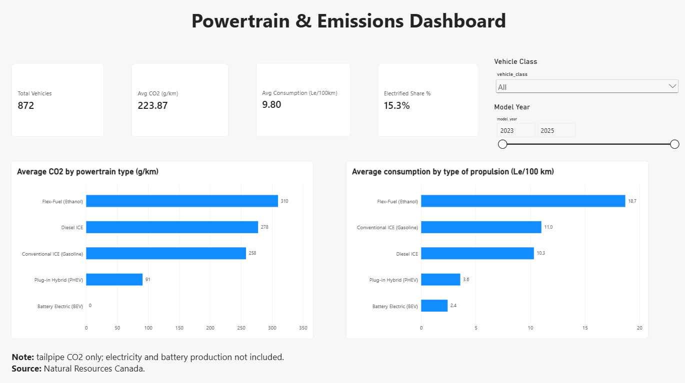

# Powertrain & Emissions Dashboard

I took three Natural Resources Canada vehicle datasets, cleaned and merged them with a Python ETL, loaded the result into BigQuery, and built the same dashboard twice, in Power BI and in Looker Studio, to compare ICE, plug-in hybrid and battery-electric vehicles on CO2 and consumption.

**Flow:** NRCan CSVs → Python ETL → BigQuery → Power BI and Looker Studio dashboards

## Dashboards

- **Looker Studio (live):** https://datastudio.google.com/s/gN-N_tdDh6o
- **Power BI:** `horse_dashboard.pbix` in this repo, preview below
- **PDF export of the Looker Studio report:** [docs/Powertrain_Dashboard.pdf](docs/Powertrain_Dashboard.pdf)



Both versions show the same four KPIs (872 vehicles, 223.87 g/km average CO2, 9.80 Le/100 km average consumption, 15.3% electrified), a vehicle-class and model-year filter, and two bar charts by powertrain type.

| Powertrain | Vehicles | Avg CO2 (g/km) | Avg consumption (Le/100 km) |
|---|---|---|---|
| Battery Electric (BEV) | 90 | 0 | 2.4 |
| Plug-in Hybrid (PHEV) | 43 | 91.1 | 3.6 |
| Diesel ICE | 18 | 277.5 | 10.3 |
| Conventional ICE (Gasoline) | 715 | 258.0 | 11.0 |
| Flex-Fuel (Ethanol) | 6 | 309.7 | 18.7 |

## The data

Source: Natural Resources Canada, Government of Canada Open Data. Three CSVs:

- `real_fuel_consumption.csv`: conventional vehicles, 739 rows (2024 ratings)
- `plugin_hybrid_vehicles.csv`: plug-in hybrids, 43 rows (2023–2024)
- `battery_electric_vehicles.csv`: battery-electric vehicles, 90 rows (2023–2025)

The ETL merges them into `cleaned_horse_powertrain_data_v2.csv`: **872 rows × 16 columns**, with the powertrain type taken from the dataset each vehicle comes from, plus an `eco_score` and an `efficiency_tier`. A few SQL queries I used for the KPIs are in `queries_v2.sql`.

## Run the ETL

On Windows (PowerShell), from the project folder:

```powershell
python -m venv venv
.\venv\Scripts\Activate.ps1
pip install -r requirements.txt
python etl_pipeline_v2.py
```

It reads the three CSVs from the same folder and writes `cleaned_horse_powertrain_data_v2.csv`.

## What I got wrong and fixed

**PHEV consumption wasn't comparable.** I was using the gasoline-only column for plug-in hybrids, so electricity was ignored while BEVs were in Le/100 km, and the PHEV average looked like 8.5. I now parse the combined Le/100 km figure, which includes electricity, and the average is 3.6.
## Limitations

- **CO2 is tailpipe only.** BEVs are 0 g/km by definition, so electricity generation and battery production aren't counted.
- **ICE only exists for 2024** in my data, so the model-year filter removes ICE vehicles when you select 2023 or 2025, and the year-over-year view says little.
- **`eco_score` depends on the dataset.** It's scaled against the highest CO2 value in the current data, so adding vehicles can change every score.
